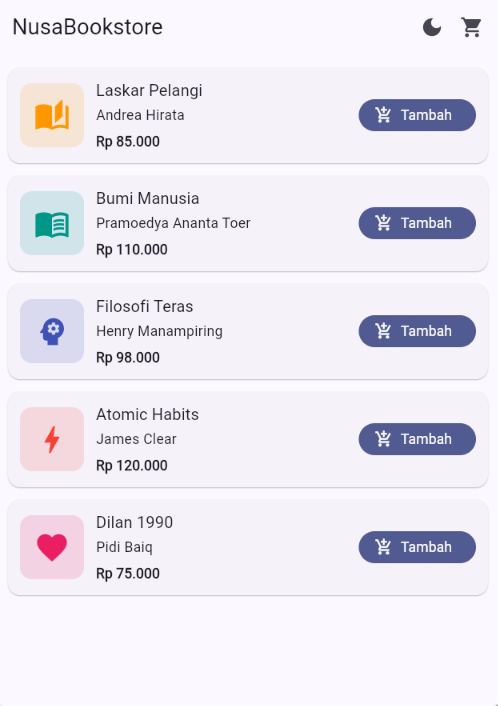
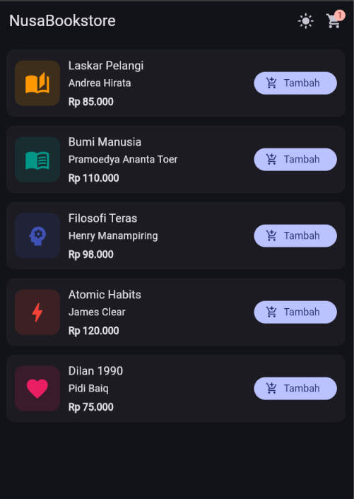
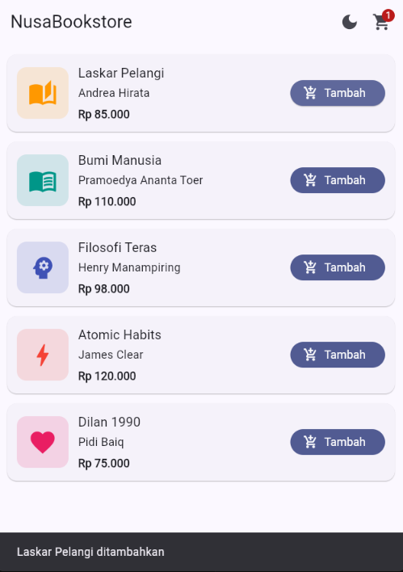
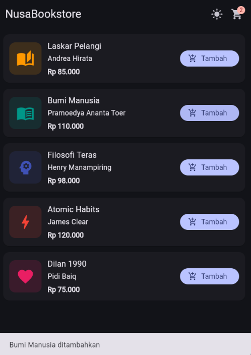
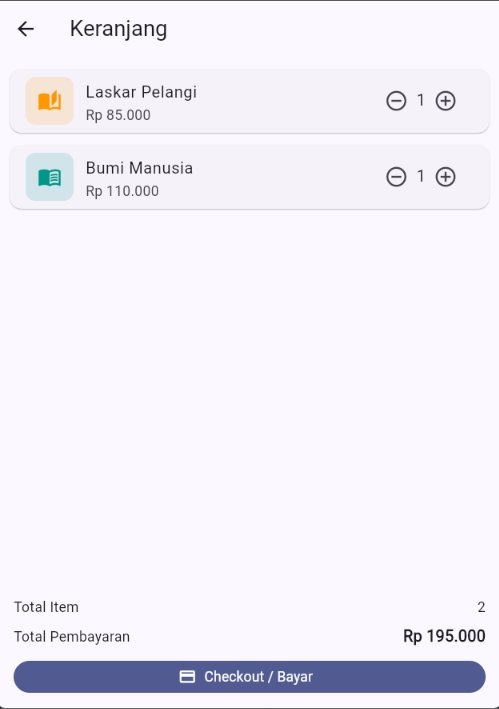
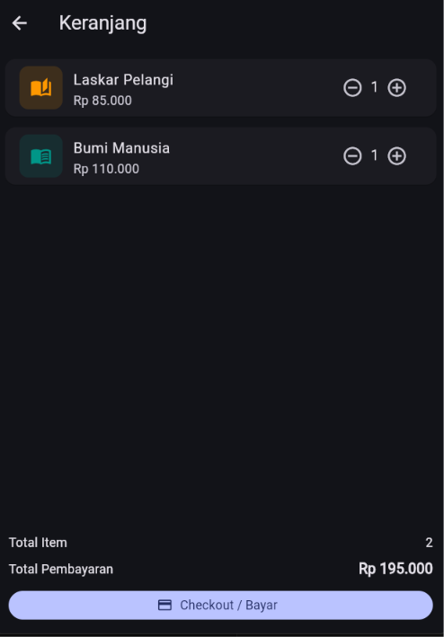
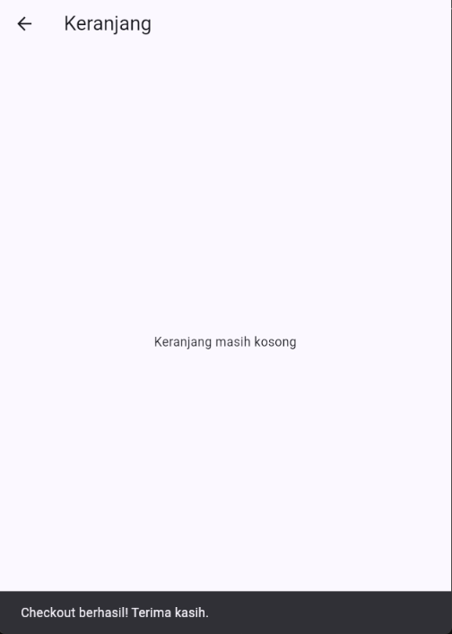

# NusaBookstore

Aplikasi toko buku sederhana berbasis Flutter untuk mempraktikkan **State Management menggunakan Provider**.

## Fitur

- Katalog buku (5 buku) dengan ikon placeholder
- Tombol **Tambah** untuk memasukkan buku ke keranjang
- Badge jumlah item pada ikon keranjang di AppBar, berubah otomatis
- Halaman keranjang dengan tombol `-` dan `+` untuk mengubah jumlah
- Total Item dan Total Pembayaran (format Rupiah) yang berubah otomatis
- Checkout yang menampilkan `SnackBar` dan mengosongkan keranjang
- Light Mode dan Dark Mode yang berlaku di seluruh aplikasi

## Konsep yang Digunakan

- `ChangeNotifier`: `CartProvider` dan `ThemeProvider`
- `MultiProvider`: mendaftarkan kedua provider di root aplikasi
- `Consumer`: membangun ulang bagian UI tertentu (badge, ikon tema)
- `context.watch`: mendengarkan perubahan data di `build`
- `context.read`: memanggil fungsi (tambah, kurang, checkout, ganti tema)
- `MaterialApp`, `Scaffold`, `AppBar`, `Card`, `ListView`, `Row`, `Column`

## Struktur Folder
lib/
├── models/
│ └── book.dart
├── providers/
│ ├── cart_provider.dart
│ └── theme_provider.dart
├── screens/
│ ├── catalog_screen.dart
│ └── cart_screen.dart
└── main.dart


## Screenshot

### Halaman Katalog

| Light Mode | Dark Mode |
|---|---|
|  |  |

### Badge Jumlah Keranjang

| Light Mode | Dark Mode |
|---|---|
|  |  |

### Halaman Keranjang dengan Total Harga

| Light Mode | Dark Mode |
|---|---|
|  |  |

### SnackBar Setelah Checkout



## Cara Menjalankan

```bash
git clone https://github.com/aldissa/nusa_bookstore
cd nusa_bookstore
flutter pub get
flutter run
```

## Dependensi

- [provider](https://pub.dev/packages/provider)

##

Muhammad Aldi Syamsul Anwar, Universitas Nusaputra